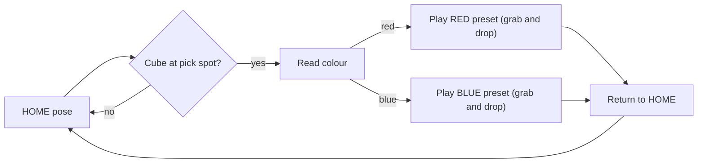

# Pechkas: Colour-Based Cube Sorter

A 5-servo robotic arm controlled by an **ESP32** that sorts cubes of two colours using **recorded ("teach-and-replay") motions**. There is no ROS, no inverse kinematics and no machine vision. You teach the arm each movement once with sliders, and a colour sensor decides which recording to play.

> **Work in progress.** The mechanical build is nearly done and firmware is being developed step by step. See the [Roadmap](#roadmap) for what's planned.

---

## Table of contents

- [Goal](#goal)
- [How it works](#how-it-works)
- [Hardware](#hardware)
- [Wiring and power](#wiring-and-power)
- [Software and toolchain](#software-and-toolchain)
- [Quick start: single-servo test](#quick-start-single-servo-test)
- [Roadmap](#roadmap)
- [Known limitations](#known-limitations)
- [Safety](#safety)
- [Acknowledgements](#acknowledgements)
- [License](#license)

---

## Goal

Pick up a cube from a fixed pick-up spot, read its colour, and drop it in the matching bin:

- **Red cube** → red bin
- **Blue cube** → blue bin

ROS is deliberately left out. For a two-colour sorter with a fixed pick-up spot, a recorded-motion approach is simpler to build, debug and understand.

## How it works

The idea is **teach-and-replay**, like a voice recorder for servo movements:

- A **pose** is one snapshot of all servo angles.
- A **preset** is a recorded sequence of servo movements and timings.
- The arm has **three presets**:
  1. **HOME**: a single safe pose where every cycle starts and ends.
  2. **RED**: grab the cube, move to the red bin, release.
  3. **BLUE**: grab the cube, move to the blue bin, release.
- A colour sensor picks which preset plays.

HOME acts as a hub: every route starts and ends there, so each cycle begins from a known, repeatable pose.

**Teaching the presets (planned):** the ESP32 will host a Wi-Fi web page with one slider per servo plus Record, Play and Home controls. You move the sliders to teach the arm, and the firmware stores each movement and its timing.

### Terminology

This method is called **teach-and-replay**. It is also known as **record-and-playback** or **teach-and-playback**. Related terms used in this project:

- **Teach pendant**: the interface used to move the arm and record poses. Here, it is the web page with sliders.
- **Joint-space waypoints**: the stored poses are servo angles, not XYZ coordinates.
- **Point-to-point (PTP) motion**: moving from one stored pose to the next.
- **Not inverse kinematics (IK)**: IK calculates joint angles from a target XYZ position using the arm's link lengths. Teach-and-replay stores the angles directly, so no kinematic model is needed. The trade-off is that the arm can only repeat what it was taught, which suits a fixed pick-up spot and fixed bins.

## Hardware

| Part | Details |
|------|---------|
| Microcontroller | ESP32 dev board (exact board: TBD) |
| Joint servos | 4 (base, shoulder, elbow, wrist). Model: TBD |
| End effector (gripper) servo | 1× 9 g micro servo. Exact model: TBD |
| Colour sensor | Planned. Model TBD (a TCS34725 is a candidate) |
| Servo power | 6.0 V supply, at least 5 A |
| Power extras | 1000 µF capacitor (16 V), inline fuse, power switch, terminal block |
| Frame and gripper | Custom mechanical design |

## Wiring and power

### Servo signal pins

| Servo | ESP32 GPIO |
|-------|-----------|
| Base | 27 |
| Shoulder | 26 |
| Elbow | 25 |
| Wrist | 32 (tentative) |
| Gripper (9 g servo) | 33 |

Servo wires are usually brown or black for GND, red for V+, and orange or yellow for signal. These GPIOs avoid the ESP32's boot-related and input-only pins. The colour sensor pins will be added once the sensor is chosen.

### Power rules

- Servos run from a **separate 6.0 V supply rated at least 5 A**. Many MG995-class servos are rated about 4.8 to 7.2 V, while 9 g micro servos are typically rated up to about 6 V, so **do not set the servo rail above 6.0 V**.
- **Connect the servo supply ground to the ESP32 ground.** This is required.
- Put a **1000 µF capacitor** across the servo V+ and GND rail, close to the servos.
- Use an **inline fuse and a switch** on the servo supply. The switch doubles as an emergency stop.
- **Never power servos from the ESP32's 5V, VIN or 3V3 pins, or from USB.**
- Don't run servo power through a breadboard. Use a terminal block.
- If you use a buck converter, set its output to 6.0 V with a multimeter **before** connecting any servo.
- Power the ESP32 from USB while developing.

## Roadmap

1. Verify each servo individually, and find each joint's safe min and max angle.
2. Build the web UI: Wi-Fi access point, sliders, Record, Play, Home.
3. Store separate RED, BLUE and HOME presets, and save them to flash.
4. Playback speed limiting and per-joint angle limits.
5. Colour sensor integration and calibration under real lighting.
6. Automatic sorting mode with a Stop and Home control.
7. Gripper and pick-up slot improvements so small position errors self-correct.

## Known limitations

- **Open-loop control.** Hobby servos give no position feedback. Repeatability is typically around 1 to 2° per joint, and errors add up across joints. At about 24 cm reach, 1° at the base moves the tip roughly 4 mm.
- **Fixed pick-up position.** The colour sensor reports colour, not position. Cubes must always arrive at the same spot (for example, in a slot or ramp).
- **Replay only, no path planning.** The arm repeats what was taught and cannot reach positions that were not recorded.
- **Presets reproduce what you recorded.** Slow, deliberate slider movements work best. Hesitations during recording are replayed too.
- **Limited gripper force.** A 9 g micro servo has modest torque (typically on the order of 1.5 to 2 kg·cm), which limits cube weight and grip force.
- **Colour detection depends on lighting.** The sensor needs shading, a fixed distance and calibration.
- **Power.** Servo stalls or a weak supply can cause ESP32 resets.
